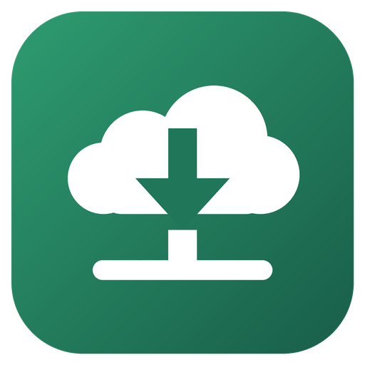

<p align="center"></p>

<h1 align="center">Minecraft Drive Backup</h1>

<p align="center">Back up a Minecraft server to Google Drive without using its disk: files and databases are compressed on the fly and streamed straight to Drive at the lowest priority, with a Discord panel.</p>

<p align="center"><a href="https://github.com/milkycloud-dev/minecraft-drive-backup/actions/workflows/ci.yml"></a></p>

<p align="center"><a href="#english">English</a> | <a href="#русский">Русский</a></p>

<a id="english"></a>

## English

### Why this exists

Most Minecraft backup tools make an archive first and upload it later. That needs as much free disk as the world itself, hits the disk the game is using, and is no help at all when your host gives you only SFTP. This tool stages nothing: every file goes through a pipe into Drive, and the game keeps the machine.

### What you get

| Source | How it is copied |
|---|---|
| Server files on the same machine | `SOURCE_TYPE=local`, read from a read-only mount |
| Server files at a host that gives only SFTP | `SOURCE_TYPE=sftp`, several parallel readers, host key pinning |
| MariaDB or MySQL | One dump per database, all of them unless you list some |
| ClickHouse | Schema plus one Native file per table, row counts in the manifest. Views are schema only |

Every backup is a dated folder on Drive with one archive per dimension, the database dumps and a `MANIFEST.json`.

- **Verified.** The md5 of every stream is compared with the md5 Drive reports. A copy gets its final name only when everything is in place. Old copies go only after the new one is safe.
- **Consistent enough to restore.** Optional `save-all` over RCON, then a second pass picks up files that changed during the copy, and the manifest records deleted paths.
- **Polite.** The worker runs as `SCHED_IDLE`, nice 19, ionice idle, `cpu.weight` 1, in its own container. The panel stays responsive beside it.
- **Takes turns.** Point `PEER_PATHS` at another backup's Drive folder and the two jobs will not run at the same time.
- **Fast compression.** `zstd --fast=1 -T1` for files, `zstd -1 -T1` for dumps. Both can be changed.

The Discord panel creates one private category with a status channel and a log channel. Only the guild owner and the ids in `ADMIN_IDS` can use it.

| Button | What it does |
|---|---|
| Refresh | Reads the current state. |
| Run now | Starts a backup. Refused while one is running. |
| Copies | Lists the copies on Drive with sizes. |
| Log | Sends the log of the last run as a file. |

The result of every run goes to the log channel. Warnings, failures, a silent worker and a day without a backup ping the owner.

### How it works

Two containers share one volume. `drive-backup` is the Discord bot and the schedule, and holds no source or database password. `drive-backup-worker` waits for a request file on the volume, runs one backup as a child process, and holds no Discord token.

For each part the worker feeds a tar stream through `zstd` into `rclone rcat`, hashing the bytes on the way. If a part fails it is removed and retried. The run stays under a `.partial-` folder until the end, and that folder is also how another job knows this one is busy.

### Security, please read this

- The rclone token usually gives **full access to your Google Drive**. Anyone who takes over the worker can read all of it. Create your own OAuth client and limit the scope if you can.
- Copies are **not encrypted**. A server tree holds plugin configs with database passwords and `server.properties` with the RCON password. Treat the Drive folder as secret, or use an rclone `crypt` remote.
- The worker gets a read-only mount of your server files. Keep the mount read-only.
- Anyone with write access to your deployment can read everything the worker reads.

### Requirements

- Docker with Compose on the machine that runs it, about 700 MB of RAM at most.
- An rclone config with a Google Drive remote.
- A Discord bot token and a guild id. The bot needs Manage Channels and Send Messages.
- Linux for the priority settings to mean anything. The image runs on amd64 and arm64.

### Setup, step by step

1. Unpack the release archive and create the config:

   ```bash
   cp .env.example .env
   chmod 600 .env
   ```

2. Copy your rclone config next to it, readable only by the worker's user:

   ```bash
   cp ~/.config/rclone/rclone.conf ./rclone.conf
   chmod 600 ./rclone.conf
   ```

3. Fill in `.env`. For a local server set `SOURCE_HOST_PATH`. For an SFTP host set `SOURCE_TYPE=sftp` and the `SFTP_*` values.

4. For `save-all` over RCON, set `RCON_HOST`, `RCON_PORT` and `RCON_PASSWORD`, and put the worker on the server's Docker network with a compose override. Without RCON the second pass still catches changed files, but the first copy may lag behind the running game.

5. Start it and press **Run now** in the new channel:

   ```bash
   docker compose up -d --build
   ```

6. Check the copy, then try a real restore into an empty folder:

   ```bash
   docker compose exec drive-backup-worker python3 -m drivebackup.engine verify <stamp>
   ```

   ```bash
   docker compose exec drive-backup-worker python3 -m drivebackup.engine restore <stamp> --to /tmp/restore-test --part server-files.tar.zst
   ```

   Databases are restored by hand with `rclone cat ... | zstd -d | mariadb`.

### Settings

| Variable | Default | Meaning |
|---|---|---|
| `JOB_NAME` | `Minecraft server` | Title of the panel |
| `SCHEDULE_TIME`, `SCHEDULE_TZ` | `04:00`, `UTC` | Daily start |
| `SCHEDULE_ENABLED` | `1` | `0` leaves only the Run now button |
| `CATCHUP_HOURS` | `6` | Run a missed slot this long after it passed |
| `DRIVE_REMOTE`, `DRIVE_ROOT` | `gdrive`, `MinecraftBackups/server` | Where copies go |
| `KEEP` | `7` | Copies kept |
| `SOURCE_TYPE` | `local` | `local` or `sftp` |
| `EXCLUDES` | `logs,cache,.cache,crash-reports,debug,plugins/.paper-remapped,world/session.lock` | Paths left out |
| `SFTP_HOST`, `SFTP_PORT`, `SFTP_USER`, `SFTP_PASSWORD`, `SFTP_KEY_FILE`, `SFTP_HOSTKEY` | | SFTP source. `SFTP_KEY_FILE` must be Ed25519. `SFTP_HOSTKEY` is `SHA256:...` and should be set |
| `READERS` | `4` | Parallel readers per part |
| `BWLIMIT_MB` | `0` | Upload limit in MB/s, `0` is none |
| `ZSTD_FILES`, `ZSTD_DB` | `--fast=1`, `-1` | Compression levels |
| `RCON_HOST`, `RCON_PORT`, `RCON_PASSWORD`, `SAVE_COMMAND` | off, `25575`, , `save-all flush` | Save before copying. On modded servers use `save-all` if a watchdog kills a blocked main thread |
| `MARIADB_HOST`, `MARIADB_PORT`, `MARIADB_USER`, `MARIADB_PASSWORD` | off, `3306` | Database source |
| `MARIADB_DATABASES` | all | Comma-separated list |
| `MARIADB_SSL`, `MARIADB_SSL_CA` | `off` | `on` encrypts, a CA file also verifies |
| `CLICKHOUSE_URL`, `CLICKHOUSE_DATABASE`, `CLICKHOUSE_USER`, `CLICKHOUSE_PASSWORD` | off, `default`, `default` | ClickHouse source over HTTP(S) |
| `PEER_PATHS` | off | Comma-separated rclone folders of other jobs to wait for |
| `PEER_WAIT`, `PEER_MAX_AGE` | `3600`, `21600` | Longest wait, and the age in seconds after which a `.partial-` folder counts as dead |

### Limits and honesty

- A running world is not a frozen one. The second pass closes most of the gap, and files that were still changing are listed in the run's notes, but a region can still be torn. Only a stopped server gives a perfect copy.
- `ionice` does nothing on a disk with scheduler `none`. If your game shares the disk, add a `blkio_config` read limit to the worker in a compose override.
- Waiting for another job is a check on a folder, not a real lock. Two jobs started in the same few seconds can overlap. After `PEER_WAIT` a job starts anyway and reports a warning.
- Google limits a user to 750 GB of uploads a day, and tokens of an OAuth client in testing mode expire after 7 days.

### Releases

Tagged versions come with a source archive and an image, `ghcr.io/milkycloud-dev/minecraft-drive-backup`, for amd64 and arm64. Changes are in [CHANGELOG.md](CHANGELOG.md).

### License

Proprietary, all rights reserved. You may run the official releases on servers that you operate. See [LICENSE](LICENSE) for the terms.

<a id="русский"></a>

## Русский

### Зачем это

Обычные инструменты бэкапа Minecraft сначала собирают архив, а потом выгружают его. Для этого нужно столько же свободного места, сколько занимает мир, диск нагружается вместе с игрой, а если хостинг даёт только SFTP, такой способ вообще не подходит. Здесь на диске ничего не копится: файлы идут потоком сразу в Drive.

### Что получается

- Файлы сервера с той же машины или с хостинга по SFTP.
- MariaDB или MySQL: отдельный дамп на каждую базу.
- ClickHouse: схема и отдельный файл Native на каждую таблицу.
- Папка с датой на Drive: по архиву на измерение, дампы и `MANIFEST.json`.
- md5 каждого потока сверяется с Drive. Старые копии удаляются только после проверки новой.
- Воркер работает с минимальным приоритетом в своём контейнере, панель в Discord остаётся отзывчивой.
- Если указать `PEER_PATHS`, две задачи не идут одновременно.
- Быстрое сжатие: `zstd --fast=1` для файлов и `zstd -1` для дампов.

### Как это устроено

Два контейнера с общим томом. `drive-backup` это бот и расписание, паролей источника и баз у него нет. `drive-backup-worker` ждёт файл-запрос на томе и запускает один бэкап, токена Discord у него нет.

### Безопасность, прочитайте это

Токен rclone обычно даёт **полный доступ ко всему Google Drive**. Копии **не шифруются**, а в файлах сервера лежат конфиги плагинов с паролями баз и пароль RCON. Считайте папку на Drive секретной или используйте remote `crypt` в rclone.

### Требования

Docker с Compose, до 700 МБ ОЗУ, конфиг rclone с Google Drive, токен бота Discord и id сервера. Приоритеты работают только на Linux. Образ собран для amd64 и arm64.

### Настройка по шагам

1. `cp .env.example .env`, `chmod 600 .env`.
2. Положите рядом `rclone.conf`, `chmod 600`.
3. Заполните `.env`: для локального сервера `SOURCE_HOST_PATH`, для хостинга `SOURCE_TYPE=sftp` и значения `SFTP_*`.
4. Для `save-all` укажите `RCON_*` и подключите воркер к сети сервера через override compose.
5. `docker compose up -d --build`, затем нажмите **Run now** в новом канале.
6. Проверьте копию через `verify` и попробуйте настоящее восстановление в пустую папку. Команды и все настройки описаны в английском разделе.

### Границы, честно

- Работающий мир не заморожен. Второй проход закрывает большую часть разницы, но регион всё равно может оказаться порванным. Идеальную копию даёт только остановленный сервер.
- `ionice` не работает на диске с планировщиком `none`. Если диск общий с игрой, добавьте воркеру лимит чтения через `blkio_config`.
- Ожидание другой задачи это проверка папки, а не настоящая блокировка. После `PEER_WAIT` задача всё равно стартует с предупреждением.
- Google ограничивает выгрузку 750 ГБ в день, а токены OAuth-клиента в режиме тестирования живут 7 дней.

### Релизы

У версий с тегом есть архив исходников и образ `ghcr.io/milkycloud-dev/minecraft-drive-backup` для amd64 и arm64. Изменения в [CHANGELOG.md](CHANGELOG.md).

### Лицензия

Проприетарная, все права защищены. Официальные релизы можно запускать на своих серверах. Условия в [LICENSE](LICENSE).
